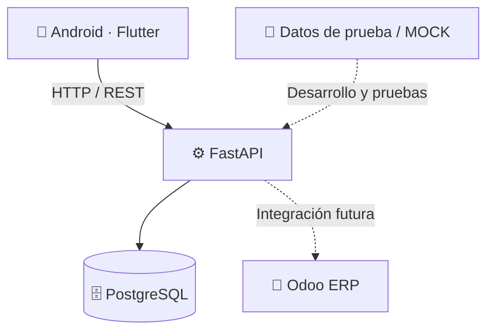

<div align="center">

# 🟠 LIA TRACE

### Inteligencia aplicada a la trazabilidad logística

**Inventario · Movimientos · Códigos QR · Operaciones industriales · Integración ERP**

[](https://github.com/sagadeangelo/LIA-Trace)
[](https://github.com/sagadeangelo/LIA-Trace)
[](https://flutter.dev/)

**[Repositorio](https://github.com/sagadeangelo/LIA-Trace) · [LIA Tech](https://lia-tech.com)**

> **Cada movimiento cuenta. Cada producto tiene una historia.**

</div>

---

## ⚡ ¿Qué es LIA TRACE?

**LIA TRACE** es una plataforma de trazabilidad logística en desarrollo, concebida para **registrar, consultar y supervisar movimientos de productos** desde una aplicación Android conectada a un backend propio.

Su objetivo es ofrecer una base tecnológica para operaciones de almacén y logística, con una experiencia de uso **industrial, clara y orientada a la acción**, y con la posibilidad de conectarse posteriormente a un sistema ERP.

La implementación inicial está **contemplada para ALCORE Puertas y Ventanas**. Esta referencia describe el contexto previsto del proyecto; no implica que exista una instalación productiva o una integración empresarial terminada.

## 🎯 Visión del producto

- 📦 **Visibilidad del inventario:** consultar productos y existencias.
- 🔁 **Trazabilidad de movimientos:** registrar entradas, salidas y devoluciones.
- 📱 **Operación móvil:** utilizar una interfaz Android diseñada para trabajo en campo y almacén.
- 🔍 **Identificación rápida:** incorporar lectura de códigos QR en el flujo operativo.
- 🧾 **Historial y evidencias:** evolucionar hacia una trazabilidad verificable de cada operación.
- 🔗 **Conectividad ERP:** preparar una futura integración con Odoo sin acoplar prematuramente el desarrollo a una instalación específica.

## 🧱 Stack tecnológico

<div align="center">


</div>

| Capa | Tecnología | Función |
|---|---|---|
| Aplicación móvil | Flutter / Dart | Interfaz Android para operaciones logísticas |
| Servicios | Python / FastAPI | API REST y lógica de negocio |
| Persistencia | PostgreSQL | Almacenamiento de información operativa |
| Infraestructura | Docker | Servicios y entorno de desarrollo |
| Integración empresarial | Odoo *(prevista)* | Intercambio futuro de información con el ERP |

## 🏗️ Arquitectura conceptual



> El diagrama muestra la **arquitectura objetivo**. La conexión con Odoo aún **no se ha implementado ni validado**.

## 📲 Experiencia industrial

La dirección visual del producto está definida para priorizar **legibilidad, rapidez y reconocimiento de estados** en entornos operativos.

| Elemento | Tratamiento visual |
|---|---|
| Base | Carbón y negro |
| Acciones principales | Naranja industrial |
| Entradas y existencias | Verde |
| Salidas y alertas | Rojo |
| Interfaz | Paneles y controles claros, pensados para Android |

> Las capturas reales de la aplicación se incorporarán a esta sección cuando estén disponibles y verificadas.

## 🧩 Módulos del sistema

Los siguientes módulos forman parte del **alcance previsto**. Su presencia en esta tabla **no significa que todos estén implementados**.

| Módulo | Propósito |
|---|---|
| 🔐 Autenticación | Control de acceso y usuarios |
| 📊 Dashboard | Resumen de la operación |
| 📷 Escáner QR | Identificación de productos |
| 📦 Inventario | Consulta de artículos y existencias |
| 📥 Recepción | Registro de entradas |
| 🚚 Embarques | Preparación y salida de productos |
| 📍 Entregas | Seguimiento de entregas |
| ⚠️ Incidencias | Registro de anomalías |
| 📸 Evidencias | Documentación de operaciones |
| 🕘 Historial | Consulta de eventos y movimientos |
| 🔄 Sincronización | Intercambio y consistencia de datos |

### Avances registrados en el repositorio

El historial de Git documenta trabajo inicial en:

- Backend MVP para inventario, devoluciones e idempotencia.
- Aplicación Android con inventario y escáner QR mediante conectividad Wi-Fi.
- Formulario de movimientos y archivos de Gradle Wrapper para Android.

**Importante:** estos son avances de código registrados en commits, **no una certificación de funcionamiento integral ni de despliegue en producción**.

## 🗂️ Organización del repositorio

```text
LIA-Trace/
├── apps/
│   └── lia_trace_mobile/      # Aplicación Flutter / Android
├── backend/                   # API y lógica de negocio
├── infrastructure/            # Infraestructura y configuración
├── shared/                    # Recursos compartidos
├── docs/                      # Documentación
├── scripts/                   # Automatización
├── .env.example               # Variables de ejemplo (sin secretos)
└── docker-compose.yml        # Definición de servicios
```

> La estructura anterior resume rutas conocidas del proyecto; consulta el árbol del repositorio para ver los archivos exactos de la versión actual.

## 🔗 Estrategia de integración ERP

LIA TRACE contempla dos modalidades de operación:

**🧪 MOCK — Desarrollo y demostración**  
Uso de datos simulados o de prueba para desarrollar y validar los flujos sin depender del ERP del cliente.

**🏢 ODOO — Integración empresarial futura**  
Conexión real con Odoo una vez confirmadas la versión, las credenciales autorizadas, los permisos y los mecanismos de integración disponibles.

**Estado actual:** no existe una conexión real con Odoo confirmada en esta etapa.

## 🛣️ Hoja de ruta

- [x] Crear la base del repositorio y los primeros componentes del MVP.
- [x] Registrar código inicial del backend de inventario y devoluciones.
- [x] Incorporar código Android para inventario y lectura QR.
- [x] Incorporar formulario Android de movimientos.
- [ ] Validar integralmente los flujos Android ↔ API ↔ PostgreSQL.
- [ ] Consolidar autenticación, permisos y manejo de errores.
- [ ] Completar módulos operativos y trazabilidad de evidencias.
- [ ] Preparar pruebas automatizadas y documentación de despliegue.
- [ ] Evaluar la integración real con Odoo según el entorno del cliente.
- [ ] Validar un despliegue piloto en un entorno autorizado.

> Las casillas marcadas indican **código o estructura registrada**, no necesariamente funcionalidades aprobadas para producción.

## 🔒 Seguridad y configuración

El repositorio contiene un archivo **`.env.example`** con valores de ejemplo para la configuración local. Los archivos `.env` reales y las credenciales **no deben publicarse**.

Antes de cualquier despliegue:

1. Crear una configuración local a partir de `.env.example`.
2. Sustituir todos los valores `CHANGE_ME` por secretos seguros y privados.
3. Verificar acceso a PostgreSQL y configuración de servicios.
4. Revisar CORS, autenticación y permisos de acuerdo con el entorno.
5. Ejecutar pruebas y verificar los comandos de inicio en la documentación técnica correspondiente.

**No utilizar este proyecto en producción sin completar las validaciones técnicas y de seguridad.**

## 📌 Estado del proyecto

**Versión:** `0.1.0`  
**Fase:** desarrollo inicial / MVP en evolución  
**Plataforma objetivo:** Android  
**Integración Odoo:** pendiente  
**Uso productivo:** no confirmado

El repositorio refleja una **base de desarrollo activa**. Algunas funcionalidades están en construcción y otras permanecen en la hoja de ruta.

## 🌐 Ecosistema LIA Tech

LIA TRACE forma parte de la evolución de proyectos tecnológicos impulsados bajo el ecosistema **LIA Tech**, que explora aplicaciones prácticas de software e inteligencia artificial en distintos sectores.

**Sitio web:** [lia-tech.com](https://lia-tech.com)  
**GitHub:** [sagadeangelo](https://github.com/sagadeangelo)

---

<div align="center">

### 🟠 LIA TRACE

**De cada movimiento, información. De la información, trazabilidad.**

*Construido paso a paso. Diseñado para evolucionar.*

</div>
